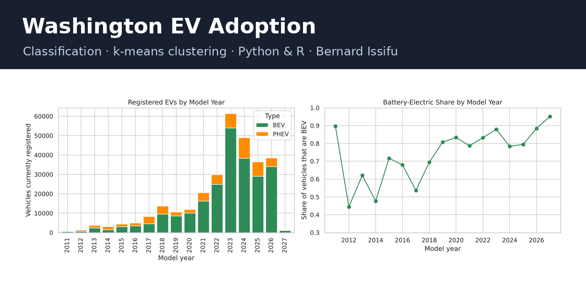

# Electric Vehicle Adoption in Washington State

A data science project on electric vehicle adoption across Washington State: whether location and model
year predict if a registered EV is fully battery-electric, and which adoption profiles exist across ZIP
codes. It combines classification models with k-means clustering on about 300,000 registered EVs.
Every analysis is implemented in both **Python** and **R**.

## Dataset

**Electric Vehicle Population Data**, Washington State Department of Licensing, published on data.wa.gov
(dataset `f6w7-q2d2`, <https://data.wa.gov/Transportation/Electric-Vehicle-Population-Data/f6w7-q2d2>),
licensed under the **Open Database License (ODbL)**. Snapshot last updated **14 October 2026**: 300,142
registered battery-electric (BEV) and plug-in hybrid (PHEV) vehicles.

- `data/ev_population.csv.gz`: the snapshot, gzip-compressed (4.4 MB), without the partial VIN, DOL
  vehicle ID and point coordinates
- `data/processed/`: cleaned data written by Part 1 (not committed; run Part 1 first, then Parts 2–3)

## Questions

1. **Can location and time predict whether a registered EV is battery-electric rather than a plug-in
   hybrid?** Classification (logistic regression, decision tree, random forest) from model year, region,
   county, city size, utility and legislative district, excluding make, model and range.
2. **What distinct EV-adoption profiles exist across Washington ZIP codes?** k-means clustering of
   ZIP-level fleet profiles (fleet size, BEV share, Tesla share, share of recent models, brand diversity).

## Contents

| Part | Python | R |
|---|---|---|
| 1. Data preparation and exploratory analysis | [`python/01_data_preparation_eda.ipynb`](python/01_data_preparation_eda.ipynb) | [`r/01_data_preparation_eda.Rmd`](r/01_data_preparation_eda.Rmd) ([HTML](r/01_data_preparation_eda.html)) |
| 2. Question 1: BEV vs PHEV classification | [`python/02_q1_classification.ipynb`](python/02_q1_classification.ipynb) | [`r/02_q1_classification.Rmd`](r/02_q1_classification.Rmd) ([HTML](r/02_q1_classification.html)) |
| 3. Question 2: ZIP-code clustering | [`python/03_q2_clustering.ipynb`](python/03_q2_clustering.ipynb) | [`r/03_q2_clustering.Rmd`](r/03_q2_clustering.Rmd) ([HTML](r/03_q2_clustering.html)) |

**Report:** [`report/issifu_bernard_ev_report.pdf`](report/issifu_bernard_ev_report.pdf) (5 pages;
Markdown source and `build_report.sh` alongside). Document-kit (LaTeX) style:
[`report/kit-version/issifu_bernard_ev_report.pdf`](report/kit-version/issifu_bernard_ev_report.pdf).
Figures and result tables from both languages are in `report/figures/`.

## Key results

- **Data:** 299,303 Washington EVs of model year 2011 onward after cleaning; 80.6% BEV, Tesla 40.7%, the
  Seattle metro 69% of all EVs. Electric range is recorded as 0 for 66% of vehicles, so it was not used.
  Python and R produce the identical cleaned dataset.
- **Question 1:** test ROC-AUC 0.620 (logistic regression), 0.649 (decision tree), 0.651 (random forest);
  R gives 0.620 / 0.639 / 0.651. Model year dominates (permutation AUC drop 0.098 vs at most 0.011 for any
  location feature); location predicts type only modestly. Make and model alone give AUC 0.9997.
- **Question 2:** four ZIP-code profiles (k = 4): Tech-suburb Tesla hubs (54 ZIPs, 86.1% BEV, 48.5%
  Tesla), Diverse urban and suburban (127), PHEV-leaning mixed fleets (81, 72.4% BEV) and Small eastern
  Tesla-leaning (76, 42.2% Tesla). R assigns the same profile to all 338 ZIP codes.

## How to run

- **Python:** from `python/`, run the notebooks in order (pandas, numpy, matplotlib, seaborn,
  scikit-learn).
- **R:** from `r/`, render each file in order with `rmarkdown::render("01_data_preparation_eda.Rmd")`
  and so on (dplyr, tidyr, ggplot2, rpart, randomForest, pROC, cluster). Part 3 in R also reads the
  Python cluster file in `report/figures/` to compare assignments.
- **Report:** from `report/`, run `./build_report.sh` (needs pandoc and Chromium); the LaTeX version is
  built with the document kit's `make_pdf.py` on the Markdown in `report/kit-version/`.
