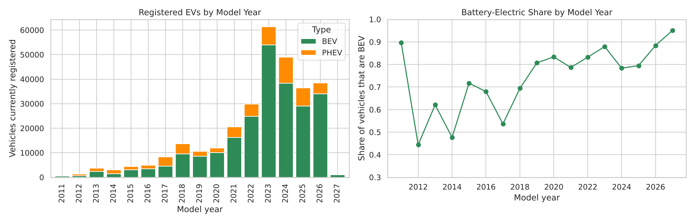
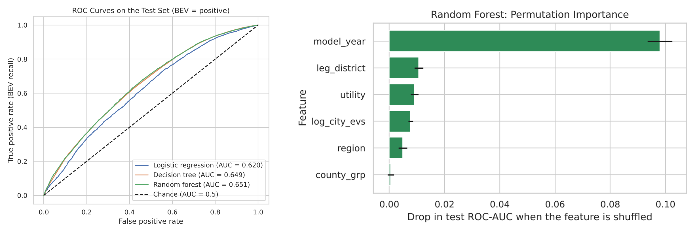
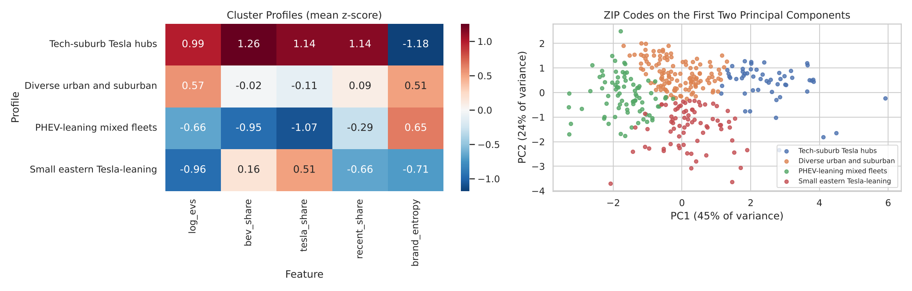

# Introduction

Electric vehicles (EVs) are central to cutting transport emissions, the largest source of greenhouse
gases in Washington State. This project uses the **Electric Vehicle Population Data** published by the
Washington State Department of Licensing on data.wa.gov (Open Database License; snapshot of 14 October
2026), which lists all 300,142 battery-electric (BEV) and plug-in hybrid (PHEV) vehicles registered with
the state. Each record gives the vehicle's county, city and ZIP code, model year, make and model, EV type,
electric range, eligibility for the state's clean-fuel incentive, legislative district, electric utility
and census tract.

Cleaning kept the 299,303 vehicles registered in Washington with complete location fields and a model
year of 2011 or later. Electric range turned out to be recorded as 0 ("not yet researched") for 66% of
vehicles, almost all from model year 2021 onward, so it was not used. Features were added for region
(Seattle metro, other western WA, eastern WA), primary utility, and an urbanity proxy (EVs registered in
the same city). Adoption has grown steeply, peaking at 61,316 registered vehicles of model year 2023; 80.6%
of vehicles are BEVs, Tesla accounts for 40.7%, and the Seattle metro (King, Snohomish and Pierce counties)
holds 69% of all EVs. All analysis was done in both Python and R, with matching results.

# Question 1: Can location and time predict whether an EV is battery-electric?

## Introduction

A battery-electric car cuts tailpipe emissions entirely, while a plug-in hybrid still burns petrol on
longer trips. If rural or older-registration areas lean towards hybrids, planners might respond with
charging infrastructure or targeted incentives. This question asks whether *where and when* a vehicle is
registered predicts its type (BEV or PHEV). It uses model year, region, county, city size, utility and
legislative district, and deliberately excludes make, model, range and incentive eligibility, which all
but define the type (make and model alone give a test AUC of 0.9997).

## Approach

Three classifiers were compared: **logistic regression** (odds ratios show each factor's direction), a
**decision tree** (depth 6, at least 200 vehicles per leaf) and a **random forest** (200 trees). Numeric
features were standardized and categorical ones one-hot encoded. Because 80.6% of vehicles are BEVs,
classes were weighted inversely to their frequency, and models were judged by **ROC-AUC**, **balanced
accuracy** and the recall of each type rather than by accuracy. The data were split 80/20, stratified on
the outcome, with 5-fold cross-validation on a 50,000-vehicle subsample; the random forest was trained
on an 80,000-vehicle subsample to limit run time. **Permutation importance** measured each feature's
contribution.

## Data analysis and results

| Model | CV ROC-AUC | Test ROC-AUC | Balanced accuracy | BEV recall | BEV precision | PHEV recall | Test ROC-AUC (R) |
|----------------|-------------|------|------|------|------|------|------|
| Logistic regression | 0.616 ± 0.008 | 0.620 | 0.582 | 0.615 | 0.850 | 0.548 | 0.620 |
| Decision tree | 0.646 ± 0.008 | 0.649 | 0.604 | 0.641 | 0.860 | 0.568 | 0.639 |
| Random forest | 0.644 ± 0.010 | **0.651** | **0.608** | 0.656 | 0.861 | 0.560 | 0.651 |

: Test-set performance (Python, threshold 0.5); the last column shows the R replication.

All models beat chance but only modestly (test ROC-AUC 0.62–0.65, Table 1). The tree-based models beat
logistic regression because the BEV share moves non-linearly with model year (Figure 1). **Model year**
dominates: shuffling it lowers the random forest's AUC by 0.098, about ten times any location feature
(Figure 2), and each standard deviation of model year (about three years) raises the odds of a BEV by 39%.
Location adds little: legislative district (0.011), utility (0.009), city size (0.008) and region
(0.005). The BEV share rises from 75.5% in cities with fewer than 100 EVs to 82.3% in cities with
5,000–20,000, and Seattle City Light customers have 1.36 times, and PacifiCorp customers 0.60 times, the
odds of Bonneville Power Administration customers of driving a BEV.

## Discussion

When a vehicle was built matters far more than where it is registered. The urban–rural gap is real but
small: rural and eastern buyers lean slightly towards plug-in hybrids, consistent with longer trips and
sparser charging, but location cannot reliably tell a BEV from a PHEV. The choice is driven mainly by
the models available in a given year and by brand. The two languages agree on performance and on the
ranking of features. One difference is that R's unpenalized logistic regression attributes the region
effect to the overlapping county terms (Seattle metro odds ratio 1.05 against 1.29 in Python). Limitations:
the data count vehicles currently registered rather than sales, city size is derived from the EV data
itself, and some models were trained on subsamples.

# Question 2: What EV-adoption profiles exist across Washington ZIP codes?

## Introduction

Adoption is uneven across the state, and utilities and planners need to know *what kind* of EV market
each area is, not only how many EVs it has. This question groups ZIP codes by the make-up of their EV
fleet. It uses the 338 ZIP codes with at least 50 EVs (covering 99.0% of all EVs), each described by its
fleet size, BEV share, Tesla share, share of recent models and brand diversity. I am interested in it
because such profiles can guide where to build which kind of charging.

## Approach

**k-means clustering** was applied to five standardized ZIP-level features: log10 number of EVs, BEV
share, Tesla share, share of model year 2023 or later, and brand diversity (Shannon entropy of makes).
Standardizing gives each feature equal weight. The number of clusters was chosen with the **elbow
method** and the **average silhouette width** for k = 2 to 8. The silhouette was highest at k = 2
(0.304), which only separates large from small markets, and varied little from k = 3 to 8 (0.250–0.273).
**k = 4** was chosen for interpretability, accepting a slightly lower silhouette (0.250); k = 5 split off a
group of only 4 ZIP codes. Clusters were named by fixed rules so that Python and R label them the same
way, and profiled by their feature means and region mix.

## Data analysis and results

| Profile | ZIP codes | EVs | Median EVs per ZIP | BEV share | Tesla share | Model year 2023+ | Share in Seattle metro |
|----------------------------|-----|---------|------|------|------|------|------|
| Tech-suburb Tesla hubs | 54 | 110,724 | 1,902 | 86.1% | 48.5% | 67.6% | 91% |
| Diverse urban and suburban | 127 | 143,034 | 1,013 | 78.2% | 36.0% | 60.7% | 54% |
| PHEV-leaning mixed fleets | 81 | 26,490 | 206 | 72.4% | 26.3% | 58.2% | 16% |
| Small eastern Tesla-leaning | 76 | 15,937 | 146 | 79.3% | 42.2% | 55.7% | 21% |

: The four ZIP-code profiles (k-means, k = 4). R assigns the same profile to all 338 ZIP codes.

The **Tech-suburb Tesla hubs** (Redmond, Bothell, Kirkland, Bellevue, Sammamish) have the largest, newest
and most Tesla-heavy fleets with the least brand variety. The **Diverse urban and suburban** group (north
Seattle, Woodinville, Olympia, Camas) holds the most EVs overall, with an average BEV share and the widest
mix of brands. The two small-market profiles differ sharply: **PHEV-leaning mixed fleets** (Tukwila,
Bellingham, Renton, Sequim, Port Townsend) have the lowest BEV and Tesla shares, while the **Small eastern
Tesla-leaning** group (Pasco, Kennewick, Moses Lake, Ellensburg; 49% in eastern Washington) combines the
smallest and oldest fleets with a high Tesla share (Table 2, Figure 3).

## Discussion

EV adoption is not a single urban–rural gradient. Large markets split into a premium, Tesla-dominated
Eastside and a broad mainstream market, and small markets split into hybrid-leaning areas with many
brands and eastern towns where a few Tesla buyers dominate, perhaps because Tesla's own fast chargers
along the I-90 and I-82 corridors make a battery-electric car practical there. This suggests different
priorities: more public charging where hybrids dominate, and non-Tesla fast charging in eastern towns so
that other brands become viable. Python and R produced identical clusters. Limitations: the silhouette is
modest, so the profiles overlap; ZIP codes vary greatly in size; and without population data the
analysis describes fleet composition, not adoption rates per household.

# References

Washington State Department of Licensing (2026). *Electric Vehicle Population Data*. data.wa.gov,
dataset f6w7-q2d2, Open Database License (ODbL). Snapshot of 14 October 2026.

Han, J., Pei, J., & Tong, H. (2023). *Data Mining: Concepts and Techniques* (4th ed.). Morgan Kaufmann.

**Code:** `python/01–03_*.ipynb` and `r/01–03_*.Rmd` in the project folder reproduce every result.
